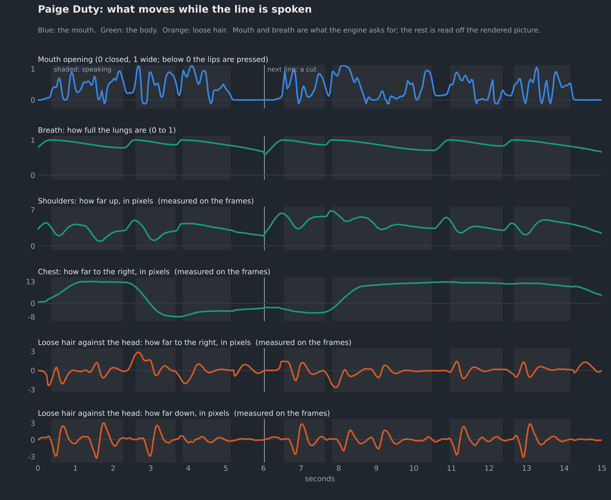

# The body breathes and shifts, the hair swings, and the lips are let loose

Request 11 came as three messages: "And also body not needs to move a bit as well as hair and need to be as realistic
as possible", "I meant needs to move", and "His lips are too tight". While the work was under way two more arrived:
"claude/audio-and-polish push" (the branch was already on GitHub in full; everything since has been pushed to it) and
"can you publish current state than continue?" (both pages were published at 12:15 and work went on).

As before, the agent that built this cannot watch a moving picture or listen. It looks at still frames and it
measures. What follows says which.

**Who "he" is.** The last "he" in the conversation was the guest, Y. A. Mel, and his is the tightest mouth of the
five. But what made his lips tight turned out to be true of every presenter, so all five were changed.

## Summary

| Area | Before (request 10) | After |
|---|---|---|
| Body | the whole figure, head and all, turned 0.3° about a point below the frame and swelled by a third of a percent as "breathing" | the torso breathes (shoulders rise before each phrase and sink while it is spoken), shifts its weight, tilts, turns part of the way with the head and dips into stressed words; the head rides on it |
| Hair | fixed to the head | loose hair hangs on a spring: it follows the head late and swings past; the reporter's curls catch the wind |
| Lips | every mouth pose was the photograph's closed-lip smile plus a jaw opening | every pose is built on a relaxed mouth; the photograph's smile is what a presenter wears while listening |
| The guest's jaw | widest pose opened 0.18 eye distances | 0.29 |
| How far mouths open | loud-end opening 0.13 eye distances; the presenter the reference opened furthest was scaled down by a fifth | 0.155 for everyone; nobody is scaled down |
| Plate behind each presenter | the fill was blurred from 8 px outside the outline | real background right up to the outline; the fill softens with depth |
| Weather presenter | looked into the camera throughout | glances at the map she is presenting |
| Demo page | | a "Body and hair movement" switch, and a breath lane in the chart |

## "His lips are too tight"

### What was wrong

Every presenter was photographed with a closed-lip smile. Every mouth pose was made by adding a jaw opening (and
lip rounding or spreading) to that photograph. So all five talked through a held smile: corners pulled wide, lips
stretched thin, the mouth a slit. `tests/output/phon_cy.jpg` and `phon_dee.jpg` show the co-anchor and the reporter
doing it. On the guest it was worst, for two more reasons: his smile is the tightest, and his widest pose opened
only 0.18 eye distances where the others reach 0.21 to 0.23 (`tests/output/poses_big_mel2.jpg`).

A first grid of renders settled what helps (`gen/relax_grid_mel.py`, `gen/out/relax_grid_mel.jpg`; the same for the
other four in `gen/out/relax_grid_<name>.jpg`):

- taking a quarter out of the smile, plus a little lip rounding, gives fuller lips and a mouth that looks like speech;
- half out of the smile is too much: the corners turn down;
- his jaw can be driven to 90 units (the old maximum was 60) and is still a believable open mouth; 120 is a shout.

### The relaxed mouth (`gen/lpx4.py`)

The whole pose set was rendered again, 65 poses a face, around a relaxed mouth:

| Presenter | Smile taken out | Lips forward | Jaw travel |
|---|---|---|---|
| Paige | 0.10 | 2 | as before |
| Cy, Dee, Sunny | 0.20 | 3 | as before |
| Mel | 0.25 | 4 | 1.5 times as far for the same setting |

(Units are the re-posing model's sliders: 0.38 is the broad smile, 15 is fully pursed lips. Paige's photograph has
hardly any smile, so she is changed least.)

The 65: the relaxed mouth itself; the photograph's own expression; eleven jaw openings with relaxed lips; eight each
with lips half and fully spread and half and fully rounded; eight while smiling broadly; lips pressed; lids half and
fully closed; eyes left, right and down; head turned and nodded both ways; brows raised and lowered. Spread lips
are not pushed forward; rounded ones are pushed further. Rendering took 7 to 14 minutes a face (about 6.5 s a pose,
slower while measurements ran alongside).

What the poses look like on the page: `tests/output/poses_<name>_relaxed.jpg`; the guest before and after at the same
four settings: `poses_big_mel2.jpg` and `poses_big_mel3.jpg`; his mouth frame by frame through "Cy, the agent writes
four…": `phon_mel_relaxed.jpg`.

Measured on the renders, with the same landmark network as before (`gen/lipteach.py calib`; eye distances):

| Presenter | Opening above "shut" at jaw 16 / 32 / 60, before | after | Mouth width at rest, before | after |
|---|---|---|---|---|
| Paige | 0.063 / 0.125 / 0.213 | 0.066 / 0.129 / 0.218 | 0.775 | 0.752 |
| Cy | 0.066 / 0.127 / 0.233 | 0.067 / 0.133 / 0.247 | 0.862 | 0.809 |
| Dee | 0.059 / 0.122 / 0.231 | 0.058 / 0.122 / 0.233 | 0.824 | 0.767 |
| Sunny | 0.056 / 0.115 / 0.210 | 0.061 / 0.120 / 0.222 | 0.866 | 0.812 |
| Mel | 0.033 / 0.073 / 0.179 | 0.039 / 0.139 / 0.288 | 0.792 | 0.739 |

The relaxed mouths are 3 to 7% narrower, and the guest now opens further than anyone.

### The photograph's smile is not lost

The smile scale on the page now reads: 0 is the relaxed mouth, 0.5 is the photograph's own expression (the old
"half smile" pose is now exactly the photograph, so it is as sharp as it ever was), 1 is the broad smile. A presenter
who is not speaking sits at 0.5. The smile lets go between 0.45 and 0.15 s before their first sound and comes back
between 0.35 and 1.1 s after their last (`restAt` in `src/news.js`, on the show's clock so that it is continuous
from one line to the next). Smiles written into the script still go to 1, and the eyes join in only above 0.5.
So a listening presenter looks exactly as before, lips meet in a relaxed mouth for every m, b and p, and a smile
is now something that happens, not something worn throughout.

### How far the mouths open (`gen/lipteach.py map`)

The lip reference was measured again on the new base frames (all 16 lines of the current voices at 50 a second, both
older sets at 25). Its readings barely changed, which is as it should be: it mostly looks at the upper face.

Then the level. In request 10 each presenter's loud-end opening (the 90th percentile while speaking) was brought to
a common 0.13 eye distances, which meant the presenter the reference opened furthest, Cy, was scaled *down* by a
fifth. Now the common level is 0.155 eye distances, about a centimetre between the lips, and nobody is scaled down:

| Presenter | Reference's own loud-end opening | Scaled by, before | now |
|---|---|---|---|
| Paige | 0.114 | 1.15 | 1.36 |
| Cy | 0.161 | 0.83 | 1.00 |
| Dee | 0.078 | 1.58 | 1.98 |
| Sunny | 0.076 | 1.68 | 2.05 |
| Mel | 0.117 | 0.96 | 1.33 |

On the page's scale the typical opening while speaking is now 0.38 to 0.58 per line (it was 0.34 to 0.50) and the
widest 0.83 to 1.10. The shapes of the five distributions were compared first (median against loud end: 0.45 to
0.55 for all five), to make sure the guest's reference was not simply reading small openings as shut. It was not.

## The body

### What the page has to know (`gen/bodymap.py`)

To move a torso and hair the page needs to know where they are. A face-parsing network labels every pixel as skin,
hair, neck, cloth and so on (BiSeNet, trained on CelebAMask-HQ; ONNX weights only, the glue is in the script). It was
trained on tight crops of a face, so it is run twice: on that crop, and on a crop of the whole frame height, which is
what finds long hair lying on the chest (`gen/out/face_parse_two_crops.jpg`). From the labels and from where things
are, three maps are built, smoothed and sampled every 8 pixels (129 × 73 values each, one byte a value):

| Map | 0 means | 1 means | How it is built |
|---|---|---|---|
| body | head | torso | skin of the face is head, cloth is torso, and anything else goes by height: a ramp from the chin to just below where the clothes begin beside the neck |
| hair | on the scalp | loose | hair below the ears is freer the lower it hangs; hair that stands away from the skull is a little free; hair lying on the shoulders is held by them and swings about half as far |
| wind | sheltered | exposed | hair only (the reporter's): more the further from the face, most at the outline |

`gen/work/<name>/body.jpg` shows them over each presenter (green body, red free hair, blue wind) and
`gen/out/bodymaps.jpg` all five. The script also notes the middle of the torso, the shoulder line and the shoulder
width. Hair is 45% of Paige's cut-out and more than half of it is loose; Sunny's bob is loose in its lower quarter;
Dee's curls stand away from the skull but do not hang; Cy's hair is short; Mel has none.

### One mesh for everything (`warpGL` in `src/news.js`)

The mesh that turns and nods the head was extended. Each of its points now carries the three map values as well,
and the shader adds, to the head's own movement:

```
t  = shift + tilt × (the point, turned a quarter turn about the face) + lean × (the point, seen from the face)
t.y −= breath lift × (¼ on the head … 1 on the torso)
t.x += body × ( breath widening × distance from the middle of the torso
              + shoulder turn × (1 − u²) × (0.35 at the shoulder line … 1 from 1.4 eye distances below it) )
t  += free hair × (where the hair's spring is, relative to the head)  +  wind × (gust + flutter)
move the point by  t × pin
```

`u` runs from −1 to 1 across the shoulders, so a turn of the shoulders moves the middle of the chest and leaves the
outline nearly still, which is what a small turn looks like from the front. The collar is near the axis of the turn
and hardly moves. A tilt is about a point at the waist, well below the frame; a lean is about the face, so leaning
in makes the head a touch larger where it is.

**Pinning.** A picture has nothing beyond its edges, so where the figure meets the frame it must not lift off.
Up-and-down movement fades to nothing over the lowest half eye distance of the picture; sideways movement fades over
0.45 eye distances from each side. The figure may slide along an edge, as a leaning body does. (The first version
pinned everything in a band 0.9 eye distances tall. On the two presenters framed closest, that band held the
shoulders: the reporter's rose 3.5 pixels, and 6.5 once the pinning was changed.)

Without WebGL there is no mesh. The whole figure then leans from its bottom edge, which stays put, and rises a
little with the breath.

### What drives it (`bodyAt`, `buildSpeech`, `buildShow`)

**Breath.** Each presenter has a breath timeline on the show's clock, from 0 (empty) to 1 (full). For speech: in
through the gap before each phrase, ending 40 ms before the first sound; to full before the first phrase of a line;
after that, by an amount that depends on the time available (a 0.2 s gap allows a quick top-up of about a sixth; a
gap of a second, most of a breath); out at a tenth a second while the phrase is spoken. Between lines everyone
breathes quietly: in for about a second and a half, out for two and a half. The two are joined, so a presenter who
stays on screen between lines never skips a breath. The shoulders rise 0.11 eye distances for a whole breath and the
chest widens by 0.7%; the head takes a quarter of the rise.

**Weight and turn.** The head resettles for every phrase (request 9). The body now does too, but only on 45% of
phrases, to the side the head turns, and taking a second over what the head does in half: a shift of 0.02 to 0.07
eye distances, a turn of the shoulders, and a small lean towards or away from the camera. Under that runs a slow
drift (components of about 16, 7 and 4 seconds), larger for the two presenters who stand. The shoulders also follow a
turn of the head, smoothed over 0.3 s so that they take up a look to the side but not a quick nod; and they tilt a
hair against the head's tilt.

**Stress.** The body dips 0.022 eye distances and leans in 0.8% on a strongly stressed word, 0.12 s behind the head's nod.

**Who moves how** (`BODY` in `src/news.js`):

| Presenter | Sway | Hair's spring | Damping | Hair swing | Wind |
|---|---|---|---|---|---|
| Paige, seated | 1 | 1.8 a second | 0.32 | 1.6 | |
| Cy, seated, forearms on the desk | 0.75 | 4 | 0.5 | 0.8 | |
| Dee, standing outdoors | 2 | 3.4 | 0.42 | 1.1 | yes |
| Sunny, standing | 1.8 | 2.4 | 0.38 | 1.5 | |
| Mel, at his desk on a call | 0.9 | | | none | |

In real terms the movements are small: with an eye distance of 63 mm, a full breath lifts the shoulders about 7 mm,
a shift of weight is 1 to 4 mm at a time, and the drift moves a seated presenter's head over about a centimetre.
These are at the quiet end of what people do in front of a camera. They were set from what a real body does, in
centimetres, and from still frames; nobody has watched them.

## The hair

Loose hair hangs on a spring behind the head (`bodyAt`). The spring follows the point where the head is on screen:
the body's shift, plus the turn and nod of the head. What the spring has not yet caught up with is how far the hair
hangs back, so hair trails a movement, swings past where it should be and settles; long hair slowly (1.8 cycles a
second for Paige), a bob faster, curls faster still. Up-and-down swing is 0.6 of sideways swing, the whole is
limited to 0.14 eye distances, and each point takes as much of it as the hair map says it is free. The spring is
stepped in time with the picture in steps of 4 ms and starts afresh whenever the clock jumps (a cut, a seek).

The reporter stands outdoors, so his hair also gets wind: gusts that lean the exposed hair up to 0.04 eye distances
to one side, and a flutter of about 0.01 that travels across it and grows with the gust. The wind map keeps it to
the curls, most at the outline.

It is a warp of a photograph. Hair moves as a sheet: strands do not separate, and nothing new comes into view.

## The plate behind each presenter (`gen/lpexport3.py`)

A presenter is drawn as a cut-out over a plate: the photograph with the person removed. The hole used to be closed
by carrying the surroundings inwards and blurring the result, and the blur began 8 px *outside* the outline. That
was invisible while the figure moved by two or three pixels. Now it moves by ten to twenty, and the strip of plate it
uncovers showed a soft halo standing where the head had been (`gen/out/plates_before.jpg`,
`gen/out/plate_halo_before_after.jpg`).

The plate now keeps the real background right up to the outline (five pixels of safety). Inside, the fill is the same
carrying-inwards, softened slightly from 2 px in and heavily from 14 px in, where nothing is ever uncovered. The
uncovered strip then reads as out-of-focus background. `gen/work/<name>/plate3.jpg` are the plates.

**Tried and set aside: having the image model paint the room** (`gen/plate.py`, `gen/out/plates_tried/`). The same
checkpoint that made the photographs filled the hole while everything outside was held to the original. Left free
(strength 0.97) it painted a believable building behind the reporter, but it does not reliably carry what is beside
the outline across it: beside the anchor's hair it put a bright panel against the dark video wall, along the exact
outline of her head. Held closer to the old fill (0.65) it drew edges that follow the outline of the hole. Either
way the person's outline shows as soon as the figure moves off it, which is the one thing the plate must not do. A
side-by-side behind the reporter, moved 16 px, showed no clear gain over the softened fill
(`plates_tried/dee_moved_softened_vs_painted.jpg`). It cost two to six minutes a plate.

## The demo page

"Body and hair movement" under View switches all of the above off and on, so the same line can be watched both
ways. The chart has a sixth lane, the breath, drawn in the colour of the other things that follow the voice.

## Measurements

**The method** (`tests/body_check.js`, `tests/body_check.py`). The demo page plays a presenter's lines three times
with the camera, grain and captions off: as shown; with the hair's spring and the wind off; and with body and hair
off. Dense optical flow between matching frames gives what the body adds to the picture and what the hair adds on
top. The flow is read at the shoulders, the chest, the bridge of the nose and the loosest hair, and set against
what the engine asked for at that moment, worked out in Python with the shader's own arithmetic. So the check
covers the whole chain: timelines, maps, mesh, picture.

| Presenter | The body carries the head, sideways / up and down | Shoulders rise and fall | Shoulders, fastest / typical | Loose hair against the head, sideways / down | Measured against asked (rms) |
|---|---|---|---|---|---|
| Paige | 14.2 / 3.3 px (0.16 eye distances sideways) | 5.9 px (0.068) | 28 / 2.1 px a second | 5.6 / 6.5 px | body 0.05 to 0.11 px, hair 0.09 |
| Cy | 13.4 / 3.0 px (0.14) | 6.7 px (0.068) | 45 / 3.0 | no loose hair | body 0.03 to 0.17 px |
| Dee | 20.9 / 3.9 px (0.18) | 6.9 px (0.061) | 25 / 2.7 | spring 4.7 / 1.8 px; wind 3.6 / 1.5 px | body 0.03 to 0.32 px, hair 0.25, wind 0.44 |
| Sunny | 13.3 / 2.2 px (0.22) | 4.6 px (0.076) | 19 / 1.7 | 3.8 / 3.8 px | body 0.03 to 0.19 px, hair 0.18 |
| Mel | 11.0 / 3.2 px (0.10) | 6.8 px (0.060) | 16 / 3.6 | no hair | body 0.04 to 0.06 px |

All of each presenter's lines, 30 frames a second; pixels of the 1024-pixel-wide picture; ranges are from the smallest
to the largest value over the recording. With an eye distance of 63 mm the shoulders rise and fall over about 4 to 5 mm
and the body carries the head over 6 to 14 mm. What the picture does agrees with what the engine asks to a tenth of a
pixel or so on the body and a quarter of a pixel on hair; the wind reads a pixel short at the outline of the curls,
where the flow sees hair moving over a still wall. In every recording the figure covers between 99.7% and 102.3% of
the bottom row of the picture that it covers when still: it never lifts off the bottom edge.

`tests/output/body/stills_paige_breath.jpg` and `stills_dee_wind.jpg` show one breath and one gust as pairs of frames
with a red and cyan overlay (`tests/body_stills.py`).

`tests/output/body_check.txt` has the full output and `tests/output/body/body_<name>.png` a chart for each presenter
(`body_plot.py`): mouth and breath as asked for, shoulders, chest and hair as measured.



Other checks on the final build:

| Check | Result |
|---|---|
| Script errors on load, both pages, desktop and phone width; voice switch; close-up (`errs.js`, `demo_check.js`) | none |
| The page without the mesh (WebGL forced off) | draws and moves; the bottom edge stays put |
| iPhone-only sound code in an emulated iPhone (`ios_sound_check.js`) | runs as before on both pages |
| Sound engine, one whole bulletin (`sound_check.js`) | all 16 lines played; voice within 11.8 ms of the picture clock, mean 3.8 ms |
| Mouth on the page (`lipteach.py map`) | typical opening 0.38 to 0.58 per line, widest 0.83 to 1.10; lips tightest 35 ms before the middle of a p's silence, moved 40 ms later, as before |
| Cost of a frame, headless Chromium with software rendering | 25 ms (18 to 25 before) |
| Page sizes | the television 4.38 MB (4.25 before), the demo 6.44 MB (6.31); the picture bundle 3.27 MB (3.15) |

The videos were made from this build, the same way as before.

## Files

| File | What it is |
|---|---|
| `gen/lpx4.py` | renders the 65 poses a face around the relaxed mouth → `gen/work/<name>/lp4/` |
| `gen/bodymap.py` | the body, hair and wind maps → `gen/work/<name>/body.json`, `body.jpg` |
| `gen/lpexport3.py`, `gen/assets4.py` | the picture bundle with the new poses, maps and plates → `gen/cast3.json`, `assets.json` |
| `gen/lipteach.py` | now reads the new poses (`LIP_POSES=lp` for the old ones); the new level |
| `gen/plate.py` | the painted plates that were not used |
| `gen/relax_grid_mel.py`, `relax_grid_cast.py`, `parse_test.py` | the first looks: what loosens lips, what the parser sees |
| `src/news.js` | body, breath, hair and wind; the resting smile; the weather presenter's glances |
| `src/demo.html` | the switch and the breath lane |
| `tests/body_check.js`, `body_check.py`, `body_plot.py` | the measurement and its chart |

To make it again, from `gen/` (about an hour and a quarter on four cores: half of it the poses, most of the rest the
lip reference):

```
./venv2/bin/python lpx4.py paige cy dee sunny mel
./venv6/bin/python bodymap.py                       # needs models/parse/bisenet_resnet_34.onnx (facefusion/models-3.0.0 on the Hugging Face Hub)
./venv2/bin/python lpexport3.py && ./venv/bin/python assets4.py
./venv6/bin/python lipteach.py calib
./venv6/bin/python lipteach.py teach bundle && ./venv6/bin/python lipteach.py map bundle
LIP_FPS=25 ./venv6/bin/python lipteach.py teach bundle_second && ./venv6/bin/python lipteach.py map bundle_second
LIP_FPS=25 ./venv6/bin/python lipteach.py teach bundle_first && ./venv6/bin/python lipteach.py map bundle_first
cd .. && python3 build.py
cd tests/output && node ../body_check.js paige body_paige && ../../gen/venv6/bin/python ../body_check.py body_paige
```

## Problems and retries in this pass

1. **The pinned band held the shoulders** of the two presenters framed closest (above). Pinning is now per direction
   and per edge.
2. **The shoulders bounced.** The first chart of the guest showed them dipping 5 px on every stressed word, three
   times in two seconds, drowning the breath. The dip was halved and given a short lag.
3. **The body rocked.** The first chart of the anchor showed her chest going 16 px one way and 10 the other on
   successive phrases. The body now resettles on fewer phrases, and less far.
4. **A quick breath was too quick.** A 0.19 s gap was given 0.42 of a breath, three pixels of shoulder in a sixth of
   a second. How much is taken in now depends on the time there is.
5. **A turn of the shoulders dragged the neck sideways** under a head that stayed put. The turn now grows from the
   collar down.
6. **The shoulder line was found in the wrong place** on the anchor: with an open neckline the cloth in the middle
   starts a hand's width below the shoulders. It is now looked for beside the neck.
7. **Hair lying on the shoulders bounced as freely as hair in the air.** It now swings about half as far.
8. **The plate's halo**, and the painted plates that did not solve it (above).
9. **The fallback without WebGL lifted a corner of the figure off the bottom edge**: it turned the whole picture
   about a point below the frame. It now leans the picture from its bottom edge.
10. **Measuring.** Optical flow is unreliable in the bottom rows of a picture, so "the bottom edge does not lift" is
    checked by counting how much of the bottom row the figure covers. Speeds are taken within a line, because the
    demo cuts between lines. For a bald man the "loosest hair" was a point in the empty corner of the frame.
11. **Slow going.** Poses, the lip reference and the measurements all want all four cores; run together they took
    two to three times as long as alone.

## What is still not right, or not known

- Nobody has watched it. The amounts were chosen from how far real shoulders and heads move and from still frames.
  If the body reads as too still or too busy, the numbers to change are `BODY` and the factors in `bodyAt`.
- It is a warp of one photograph. A turned shoulder shows no new side of a jacket, cloth does not crease, hair does
  not part, and hands never come into view. Larger movements than these would show that.
- The strip of plate that a moving figure uncovers is a softened guess, not what was behind the person.
- A head still turns by six degrees at most, so a glance at the map is mostly eyes.
- There is still no pose for the lower lip against the upper teeth (f, v).
- The iPhone sound fix has still not been tried on an iPhone.
- The lip reference is a network's opinion, and the common level of 0.155 is a judgement.
